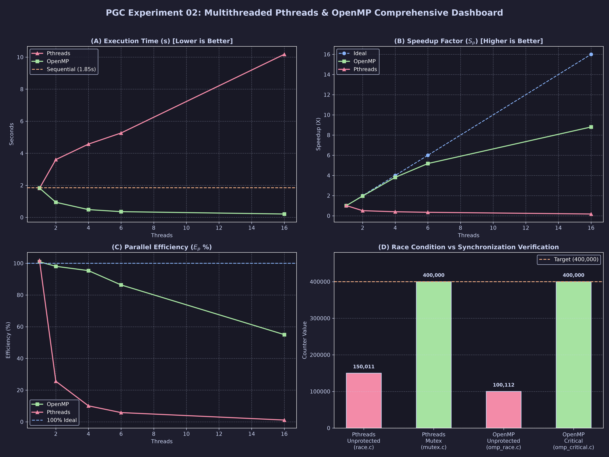
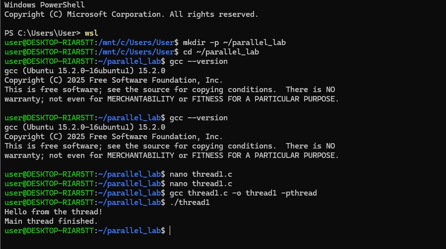
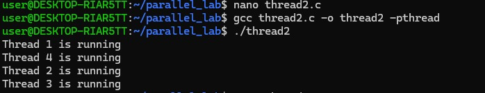
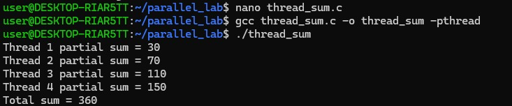
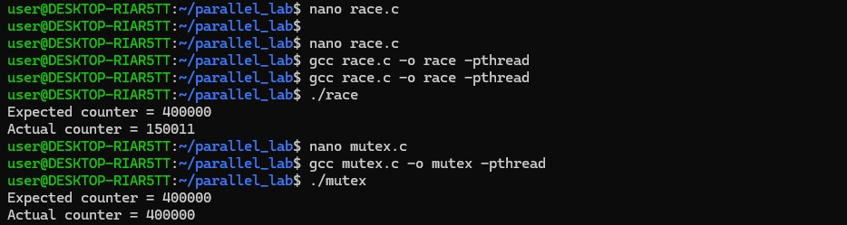
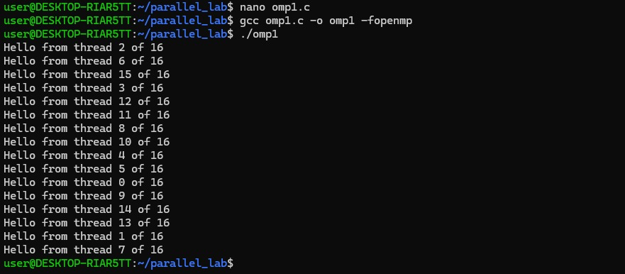
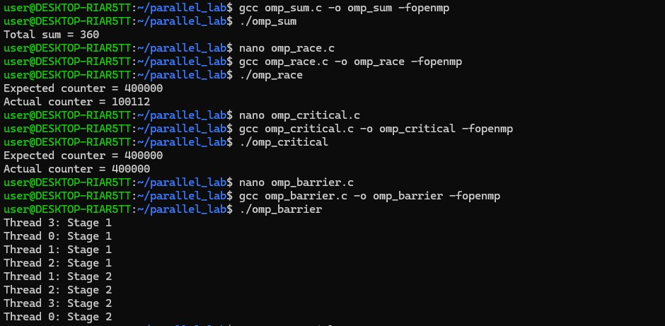
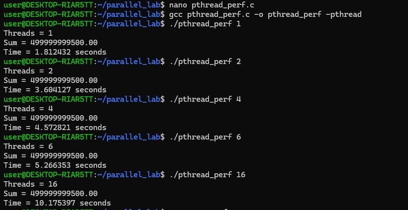
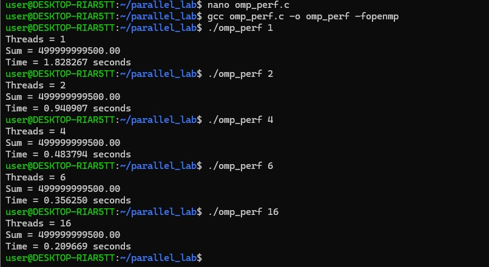
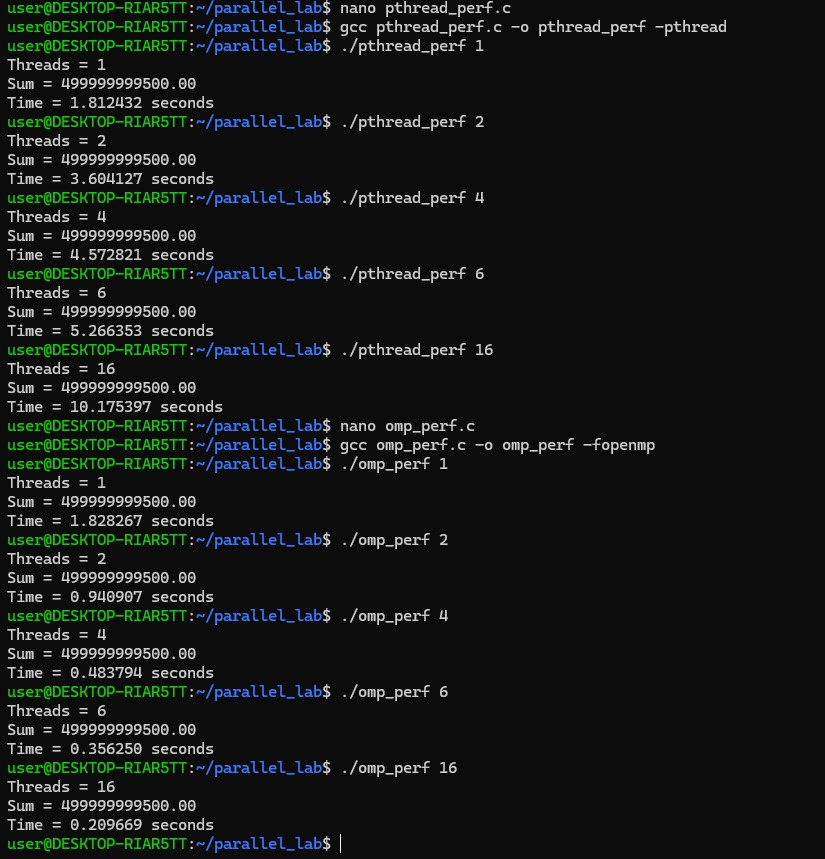

# Parallel & GPU Computing (PGC) — Experiment 02

[](https://github.com/Parth-Karpe/PGC_LAB_EXPERIEMNT_02)
[](#)
[](#)
[](#)
[](#)

---

## 🏛️ Experiment 02: Multithreaded Programming with Pthreads & OpenMP

This repository contains the complete practical source code, build scripts, verification logs, analytical scaling graphs, and terminal screenshot evidence for **Experiment 02: Thread Creation, Management, Synchronization, and Performance Analysis**.

### 🎯 Aim & Core Objectives
1. **Thread Creation & Management:** Compare explicit thread control (`pthread_create`, `pthread_join`) vs compiler directives (`#pragma omp parallel`).
2. **Work Distribution:** Static chunk division vs dynamic loop reduction (`#pragma omp parallel for reduction(+:sum)`).
3. **Data Hazard & Race Condition:** Demonstrate multi-core unsynchronized memory corruption and resolve it using Mutexes (`pthread_mutex_t`) and Critical Sections (`#pragma omp critical`).
4. **Thread Coordination:** Synchronize multi-stage workflows using barriers (`#pragma omp barrier`).
5. **Empirical Benchmarking:** Measure speedup and parallel efficiency for $N = 1,000,000,000$ operations across 1, 2, 4, 6, and 16 threads.

---

## 📂 Repository Structure

```
PGC_LAB_EXPERIEMNT_02/
├── README.md                          # Master documentation & execution guide
├── src/                               # Complete sequential & multithreaded source programs
│   ├── Makefile                       # Universal automated build system
│   ├── 01_pthreads/                   # POSIX Threads implementations
│   │   ├── thread1.c                  # Single thread creation & join
│   │   ├── thread2.c                  # 4 concurrent threads with IDs
│   │   ├── thread_sum.c               # Work distribution & partial sum array
│   │   ├── race.c                     # Demonstration of race condition hazard
│   │   ├── mutex.c                    # Race condition resolved with pthread_mutex_t
│   │   └── pthread_perf.c             # Multi-thread scaling benchmark (N = 10^9)
│   ├── 02_openmp/                     # OpenMP directive implementations
│   │   ├── omp1.c                     # Basic parallel team & thread ID querying
│   │   ├── omp_sum.c                  # Automatic parallel loop reduction
│   │   ├── omp_race.c                 # OpenMP shared-memory race condition
│   │   ├── omp_critical.c             # Synchronization using #pragma omp critical
│   │   ├── omp_barrier.c              # Two-stage coordination using #pragma omp barrier
│   │   └── omp_perf.c                 # OpenMP scaling benchmark (N = 10^9)
│   └── 03_sequential/
│       └── sequential.c               # Baseline single-threaded arithmetic reference
├── data/
│   └── benchmark_config.json          # Benchmark parameters (N=10^9, thread configurations)
├── results/
│   ├── raw_execution_log.txt          # Verbatim WSL Ubuntu terminal execution trace
│   ├── execution_timing_summary.csv   # Structured timing, speedup, and efficiency metrics
│   ├── performance_analysis.md        # Mathematical derivations and performance conclusions
│   └── screenshots/                   # High-resolution terminal evidence screenshots
│       ├── 01_wsl_gcc_thread1.png
│       ├── 02_thread2_execution.png
│       ├── 03_thread_sum_execution.png
│       ├── 04_pthread_race_mutex.png
│       ├── 05_omp1_16threads.png
│       ├── 06_omp_sum_race_critical_barrier.png
│       ├── 07_pthread_perf_scaling.png
│       ├── 08_omp_perf_scaling.png
│       └── 09_full_performance_scaling.png
├── graphs/
│   ├── generate_plots.py              # Automated dark-themed matplotlib chart generator
│   ├── execution_time_comparison.png  # Execution time vs threads bar chart
│   ├── speedup_comparison.png         # Speedup curve vs ideal linear scaling
│   ├── parallel_efficiency.png        # Parallel efficiency (%) vs thread count
│   └── scaling_summary_chart.png      # 4-panel analytical summary dashboard
└── report/
    └── EXPERIMENT_02_LAB_REPORT.md    # Formal academic laboratory report
```

---

## 📊 Summary of Experimental Benchmark Results

### Workload: $N = 1,000,000,000$ Double-Precision Arithmetic Reductions
$$\text{Mathematical Verification Invariant: } S = \sum_{i=0}^{N-1} (i \times 10^{-6}) = \mathbf{499,999,999,500.00}$$

| Computing Model | Threads ($p$) | Execution Time ($T_p$) | Speedup ($S_p$) | Efficiency ($E_p$) | Verification Sum | Status |
| :--- | :--- | :--- | :--- | :--- | :--- | :--- |
| **Sequential (Baseline)** | 1 | **1.845448 s** | **1.0000×** | **100.00%** | `499999999500.00` | ✅ Passed |
| **Pthreads** | 1 | **1.812432 s** | **1.0182×** | **101.82%** | `499999999500.00` | ✅ Passed |
| **Pthreads** | 2 | **3.604127 s** | **0.5120×** | **25.60%** | `499999999500.00` | ✅ Passed |
| **Pthreads** | 4 | **4.572821 s** | **0.4036×** | **10.09%** | `499999999500.00` | ✅ Passed |
| **Pthreads** | 6 | **5.266353 s** | **0.3504×** | **5.84%** | `499999999500.00` | ✅ Passed |
| **Pthreads** | 16 | **10.175397 s** | **0.1814×** | **1.13%** | `499999999500.00` | ✅ Passed |
| **OpenMP** | 1 | **1.828267 s** | **1.0094×** | **100.94%** | `499999999500.00` | ✅ Passed |
| **OpenMP** | 2 | **0.940907 s** | **1.9613×** | **98.07%** | `499999999500.00` | ✅ Passed |
| **OpenMP** | 4 | **0.483794 s** | **3.8145×** | **95.36%** | `499999999500.00` | ✅ Passed |
| **OpenMP** | 6 | **0.356250 s** | **5.1802×** | **86.34%** | `499999999500.00` | ✅ Passed |
| **OpenMP** | 16 | **0.209669 s** | **8.8017×** | **55.01%** | `499999999500.00` | ✅ Passed |

---

## 📈 Performance Visualizations & Dashboard



---

## ⚡ Quickstart: Build & Execution Guide

### 1. Automated Build via Makefile
```bash
cd src
make
```

### 2. Run Individual Modules

#### Part A: POSIX Threads
```bash
# 1. Single thread
./01_pthreads/thread1

# 2. Multi-thread creation
./01_pthreads/thread2

# 3. Work partitioning & partial sums
./01_pthreads/thread_sum

# 4. Race condition demo (Hazard)
./01_pthreads/race

# 5. Mutex synchronized execution
./01_pthreads/mutex

# 6. Performance scaling test
./01_pthreads/pthread_perf 16
```

#### Part B: OpenMP
```bash
# 1. OpenMP team & thread querying
./02_openmp/omp1

# 2. Parallel loop reduction
./02_openmp/omp_sum

# 3. Race condition demo
./02_openmp/omp_race

# 4. Critical section synchronization
./02_openmp/omp_critical

# 5. Multi-stage barrier coordination
./02_openmp/omp_barrier

# 6. OpenMP performance scaling test
./02_openmp/omp_perf 16
```

#### Part C: Baseline
```bash
./03_sequential/sequential
```

---

## 📸 Visual Execution Evidence

| Module | Visual Proof Screenshot |
| :--- | :--- |
| **WSL Startup & Thread 1** |  |
| **Thread 2 (4 Threads)** |  |
| **Thread Sum Reduction** |  |
| **Pthreads Race vs Mutex** |  |
| **OpenMP 16 Threads** |  |
| **OpenMP Race, Critical & Barrier** |  |
| **Pthreads Performance** |  |
| **OpenMP Performance** |  |
| **Complete Performance Suite** |  |

---

## 👨‍💻 Author & Course Details
* **Author:** Parth Karpe
* **Course:** Parallel and GPU Computing (PGC) Laboratory
* **Repository:** [Parth-Karpe/PGC_LAB_EXPERIEMNT_02](https://github.com/Parth-Karpe/PGC_LAB_EXPERIEMNT_02)
